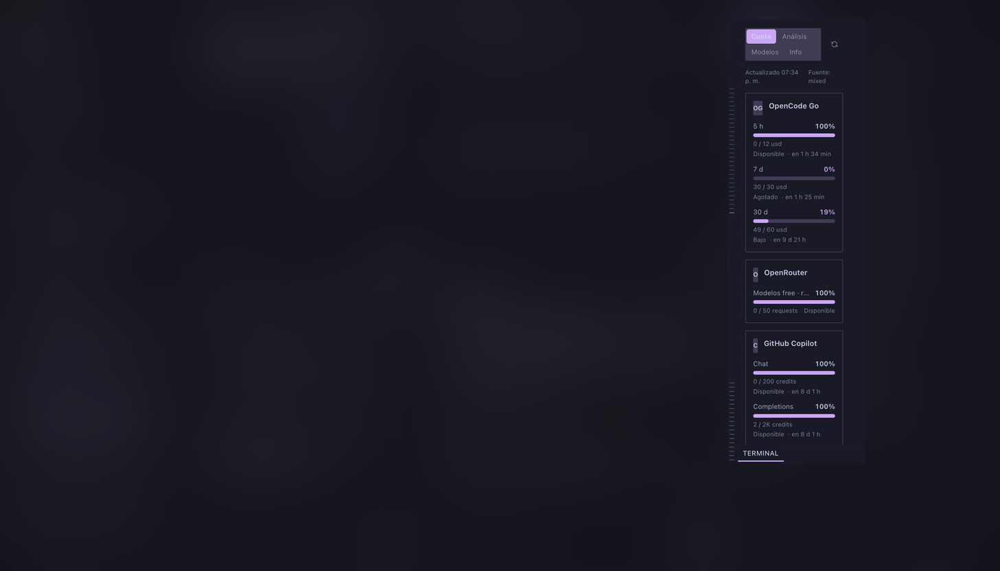

# hermes-quota-live

Panel de **cuota real** dentro del desktop de Hermes, alimentado por las APIs oficiales
de los proveedores que ya usa Hermes.


## qué muestra

| Proveedor | Fuente |
|---|---|
| OpenCode Go | `/zen/go/v1/usage` + `/console/api/go/status` → ventanas 5 h / 7 d / 30 d en USD |
| OpenRouter | `/api/v1/key` → presupuestos y requests diarios de modelos free |
| GitHub Copilot | `/copilot_internal/user` → créditos de chat y completions |
| Z.ai GLM | `/api/monitor/usage/quota/limit` → sólo con Coding Plan |
| Uso local | `~/.hermes/state.db` en solo lectura → analítica y modelos |

NVIDIA no expone API de cuota; no se inventan ventanas para ningún proveedor.

## estructura

```
plugin.yaml              # manifiesto del plugin de Hermes
__init__.py              # entrypoint del lado agente
dashboard/               # backend HTTP montado en /api/plugins/hermes-quota-live
  manifest.json
  plugin_api.py
  quota_adapters.py
desktop/plugin.js        # pane, pestañas y chip del desktop (SDK de plugins)
docs/                    # guía de instalación, proveedores y catálogo
scripts/                 # install.sh / verify.sh
tests/                   # 15 tests, sin secretos ni HTTP real
```

## arranque rápido

Ver [docs/SETUP.md](docs/SETUP.md). En corto:

```sh
./scripts/install.sh
# ⌘K → Reload desktop plugins
```

El chip `Uso N%` aparece en la barra de estado; clickealo para abrir el panel.
El porcentaje arranca en vista **Usado** y se puede cambiar a **Libre** desde el encabezado.

## privacidad

Las credenciales se resuelven en memoria desde el store de Hermes (`agent.secret_scope`)
y viajan únicamente al host oficial de cada proveedor. No se imprimen, no se persisten
y no se envían a terceros. El panel no tiene telemetría propia.

## tests

```sh
./scripts/verify.sh
```

## licencia

MIT. Ver [LICENSE](LICENSE) y [NOTICE.md](NOTICE.md) por la atribución de la UI original.
