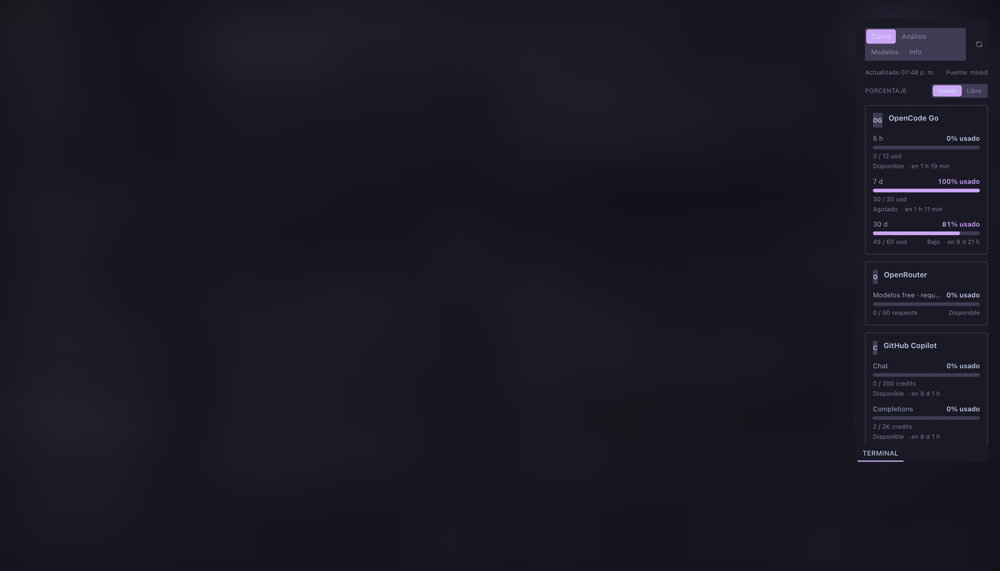

# hermes-quota-live

A **real quota** panel inside the Hermes desktop app, fed by the official APIs of the
providers Hermes already uses.



## What it shows

| Provider | Source |
|---|---|
| OpenCode Go | `/zen/go/v1/usage` + `/console/api/go/status` → 5 h / 7 d / 30 d windows in USD |
| OpenRouter | `/api/v1/key` → budgets and daily requests for free models |
| GitHub Copilot | `/copilot_internal/user` → chat and completions credits |
| Z.ai GLM | `/api/monitor/usage/quota/limit` → only with a Coding Plan |
| Local usage | `~/.hermes/state.db`, read-only → analytics and models |

NVIDIA does not expose a quota API; no provider gets invented windows.

## Layout

```
plugin.yaml              # Hermes plugin manifest
__init__.py              # agent-side entrypoint
dashboard/               # HTTP backend mounted at /api/plugins/hermes-quota-live
  manifest.json
  plugin_api.py
  quota_adapters.py
desktop/plugin.js        # desktop pane, tabs and status chip (plugin SDK)
docs/                    # setup, providers and catalog notes
scripts/                 # install.sh / verify.sh
tests/                   # 15 tests, no secrets and no live HTTP
```

## Quick start

See [docs/SETUP.md](docs/SETUP.md). In short:

```sh
./scripts/install.sh
# ⌘K → Reload desktop plugins
```

The `Uso N%` chip appears in the status bar; click it to open the panel.
Percentages default to the **Used** view and can be switched to **Free** from the header.

## Privacy

Credentials are resolved only through Hermes' secret resolver (`agent.secret_scope`) for
the variables declared in `plugin.yaml` (`requires_env`) and sent solely to each provider's
official host. No credential-store file, `.env` file, or other tool's login is read.
Values are never printed or persisted, and the panel has no telemetry of its own.

## Tests

```sh
./scripts/verify.sh
```

## License

MIT. See [LICENSE](LICENSE) and [NOTICE.md](NOTICE.md) for attribution of the original UI.
